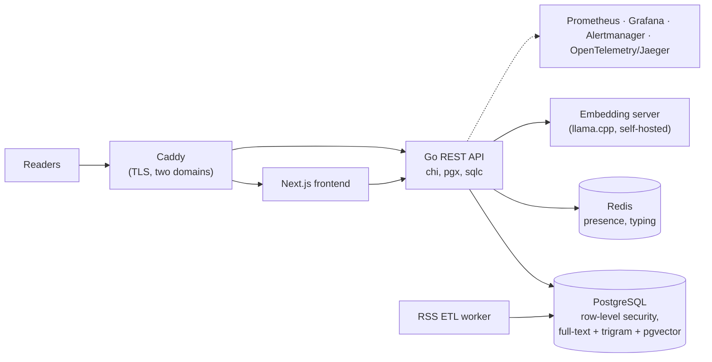

# Multi-tenant regional news platform

**Role:** sole developer, from scratch, February to May 2026 (498 commits) · **Scope:** one platform serving two regional news portals: news, classifieds, local directory, events and jobs, social feed, messaging, paid promotion, and an AI assistant

## Design decisions

- **Tenant isolation in the database.** The API sets the tenant on the PostgreSQL session for every request, and row-level security policies filter the content tables (news, classifieds, jobs, events, businesses, comments, users and others). A forgotten `WHERE` clause in application code does not leak another portal's rows. Messaging and the social wall are scoped in application code instead of RLS.
- **RLS hardening.** The API's database role owned the tables, and a table owner bypasses RLS. Migration 0011 applies `FORCE ROW LEVEL SECURITY` and demotes the role to `NOSUPERUSER NOBYPASSRLS`; migration 0045 replaced policies that exposed one portal's rows to the other.
- **Schema as code.** 50+ versioned SQL migrations with a CI check on numbering. sqlc generates typed queries for the content and identity domains; the rest is hand-written SQL through pgx. No ORM.
- **Hybrid search in one database.** Full-text search (`tsvector` + GIN, Russian configuration) for words, trigram (`pg_trgm`) for typos, and vector similarity (pgvector) for meaning, instead of a separate search cluster.
- **Retrieval assistant.** A self-hosted multilingual-e5 embedding model served by llama.cpp, retrieval in pgvector, answers streamed to the browser over Server-Sent Events. The repo keeps evaluation prompt sets for the assistant and its retrieval (`qa/llm`), and the embeddings were migrated from 1536 to 384 dimensions.
- **Presence and live updates.** Redis holds typing and presence state with short TTLs, and an SSE stream drives the live "online" counter. Direct messages are fetched by polling.
- **Background ingestion.** An RSS ETL worker ingests, cleans and categorises external news, skips duplicates by source URL per portal, and triggers a frontend cache refresh.

## Operations

- **Deploys:** Docker Compose behind Caddy (automatic TLS for both domains). GitHub Actions builds images, pushes them to GHCR and deploys. If the new version fails its health checks, the deploy script pulls back the previous image tags; database migrations are not reverted.
- **Observability:** an optional compose profile with Prometheus and Grafana for metrics, Alertmanager for alerts, and OpenTelemetry traces in Jaeger.

## Not finished

Paid promotion is built up to a payment-provider interface and promotion lifecycle. The Kaspi Pay integration waits on a merchant agreement and is not live; for production payments see [Happy End](happyend.md).
