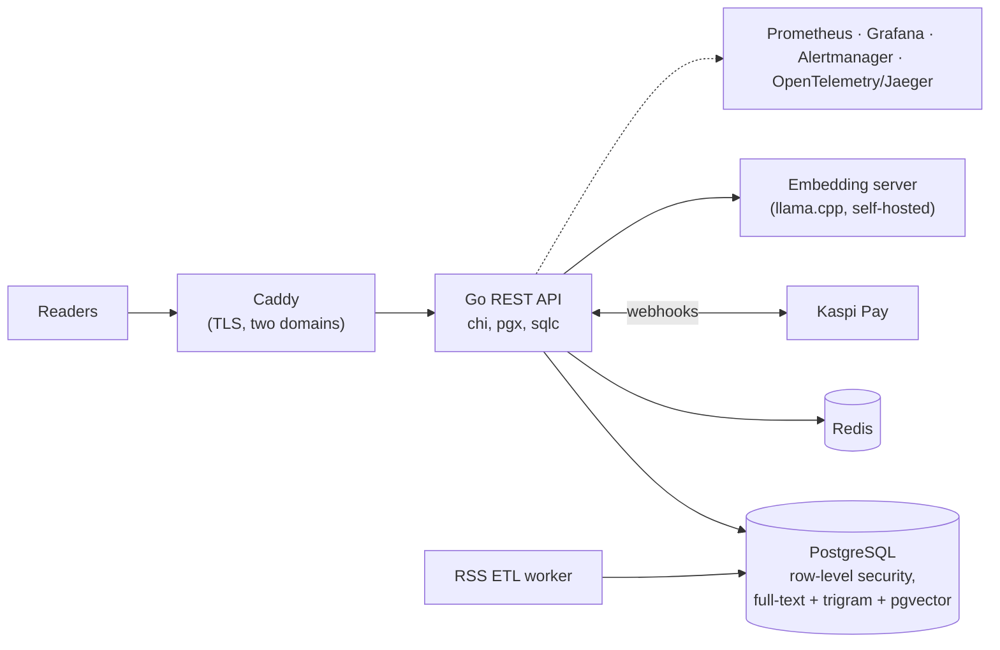

# Multi-tenant city news platform

**Role:** sole developer, from scratch, February to May 2026 · **Scope:** one platform serving two city portals (including astanatoday.kz): news, classifieds, local directory, events and jobs, social feed, messaging, paid promotion, and an AI assistant

## Design decisions

- **Multi-tenancy with PostgreSQL row-level security.** The tenant is resolved from the request's domain and set on the database session. RLS policies then filter every query, so one tenant can't read another's data even if application code forgets a `WHERE` clause.
- **Schema as code.** 55 versioned migrations, with type-safe queries generated by sqlc from SQL rather than an ORM.
- **Hybrid search.** Full-text search (`tsvector` + GIN) for words, trigram (`pg_trgm`) for typos, and vector similarity (pgvector) for meaning, all in one PostgreSQL instance instead of a separate search cluster.
- **Real-time without WebSockets.** Messaging and online presence use Redis plus Server-Sent Events, which is simpler to run behind a reverse proxy.
- **Payments.** Paid listing promotion goes through Kaspi Pay, with status driven by webhooks.
- **Background ingestion.** An RSS ETL worker ingests, cleans, categorises and deduplicates external news, then invalidates caches.
- **RAG assistant.** Embeddings come from a self-hosted model server (llama.cpp, multilingual-e5); retrieval runs in pgvector, and answers stream to the browser over SSE.

## Operations

- **Deploys:** Docker Compose behind Caddy (automatic TLS for both domains). GitHub Actions builds images, pushes them to GHCR and deploys, **rolling back automatically when the new version fails its health checks**.
- **Observability:** Prometheus and Grafana for metrics, Alertmanager for alerts, OpenTelemetry traces in Jaeger.
