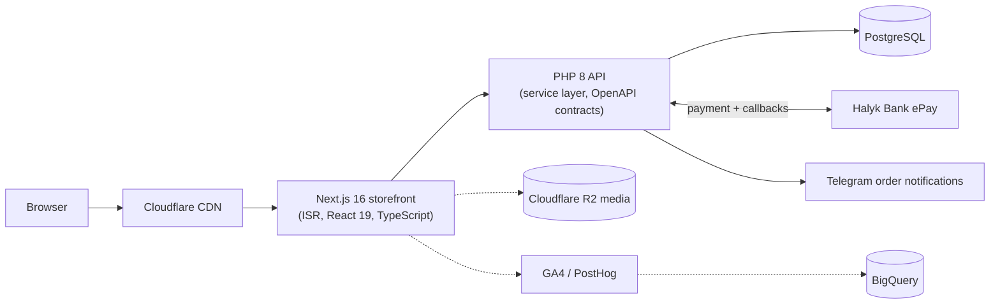

# Happy End: e-commerce platform

**Role:** sole developer, April 2026 to present · **Scale:** happyend.kz plus two regional sites (Astana, Uralsk), ~7,000 monthly users, a catalog of 2,400+ products

## The problem

The store ran on 1C-Bitrix. It was slow to change, hard to test, and every new feature meant fighting the platform. The goal was to replace it with a stack I fully control, without losing orders, payments or gift certificates, and without downtime the business would notice.

## What I built

- **Storefront:** Next.js 16, React 19 and TypeScript. Catalog, search and filters, cart, checkout, customer accounts (Better Auth), and SEO for three cities.
- **Payments:** Halyk Bank ePay with callback status handling, promo codes and gift certificates.
- **API and admin:** a PHP 8 API with a service layer, repositories and OpenAPI contracts, plus an admin panel for products, orders, content, promotions and certificates with role-based access.
- **Analytics:** GA4 and PostHog e-commerce events, channel attribution, GA4 → BigQuery export and SQL reports, and an automated weekly Telegram digest.
- **Performance:** Next.js ISR and caching, Cloudflare CDN, media on R2, duplicate database queries removed.
- **Quality and infrastructure:** Docker Compose, Caddy, GitHub Actions CI/CD and Sentry. 3,700+ automated tests (Vitest, Playwright, Pest), PHPStan, ESLint, Rector.

## The migration

The hard part was moving live data from Bitrix (MySQL) to PostgreSQL:

1. **Idempotent import scripts** for the catalog, orders, payments and gift certificates, safe to re-run any number of times, so I could rehearse the migration repeatedly against fresh copies of production.
2. **A runbook for cutover day:** write freeze on the old store, final backup, final import, per-domain verification (each city site checked separately), then the DNS switch.
3. The production cutover was completed in **September 2026**, and Bitrix is fully retired.

## What I'd point out

- Payment state is driven by the bank's callbacks, not by the browser redirect. A customer closing the tab after paying still ends up with a paid order.
- With 3,700+ tests, refactoring is cheap. That mattered most during the migration, when the same flows had to keep working against a new database.
