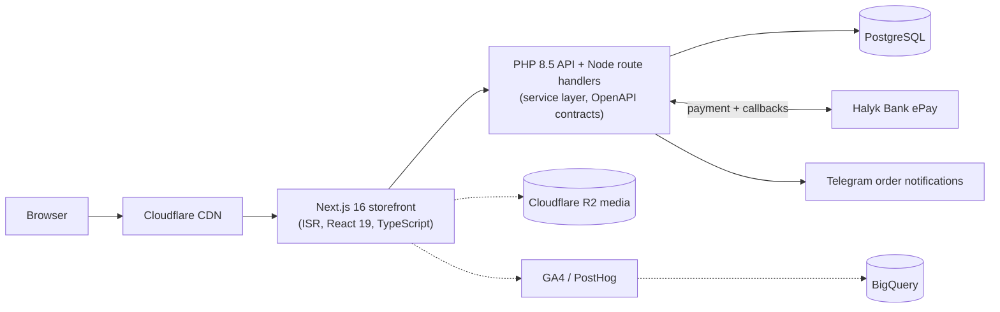

# Happy End: e-commerce platform

**Role:** sole developer, April 2026 to present (1,900+ commits) · **Scale:** happyend.kz plus two regional sites (Astana, Uralsk), ~7,000 monthly users, a catalog of 2,400+ products

## The problem

The store ran on 1C-Bitrix. It was slow to change, hard to test, and every new feature meant fighting the platform. The goal was to replace it with a stack I fully control, without losing orders, payments or gift certificates, and without downtime the business would notice.

## What I built

- **Storefront:** Next.js 16, React 19 and TypeScript. Catalog, search and filters, cart, checkout, customer accounts (Better Auth), and SEO for three cities.
- **Payments:** Halyk Bank ePay, promo codes and gift certificates. Certificate fulfilment is idempotent, so a repeated bank callback never issues a second certificate.
- **API and admin:** a PHP 8.5 API with a service layer, repositories and OpenAPI contracts, plus an admin panel for products, orders, content, promotions and certificates with role-based access.
- **Analytics:** GA4 and PostHog e-commerce events, channel attribution, GA4 → BigQuery export and SQL reports, and an automated weekly Telegram digest.
- **Performance:** Next.js ISR and caching, Cloudflare CDN, media on R2, duplicate database queries removed. Stock and prices sync from the MoySklad inventory system through a webhook receiver.
- **Quality and infrastructure:** Docker Compose, Caddy, GitHub Actions CI/CD and Sentry. 4,400+ automated tests (Vitest, Playwright, Pest), PHPStan level 8, ESLint, Rector. A written security audit in October 2026 led to fixes for its critical findings.

## The migration

The hard part was moving live data from Bitrix (MySQL) to PostgreSQL:

1. **Idempotent import** of the catalog (2,400+ products), customers, promo codes and gift certificates. A MariaDB snapshot was restored into an isolated container and copied entity by entity with `INSERT ... ON CONFLICT` upserts in transactions: dry run by default, `--apply` to write, and a count reconciliation before cutover. Re-running never duplicates data. Historical Bitrix orders go into a separate archive table and never overwrite native orders. Old customers can still log in, because the legacy password hashes are verified and migrated on first sign-in. The one-off import script was removed after cutover and is kept in git history.
2. **Cutover by runbook:** a write freeze on the old store, an off-host encrypted backup, the final import, count comparisons for accounts, orders, promo codes, certificates and stock, and per-domain checks for happyend.kz and the Astana and Uralsk sites.
3. The production cutover was completed on **15 September 2026**. The Bitrix endpoints now return retired responses, and the historical data stays as a read-only archive.

## What I'd point out

- Halyk's callback carries no signature, so it is treated only as a trigger. The order is marked paid after the API asks Halyk's status endpoint directly and the amount matches. A scheduled sweep catches customers who never return to the site, so closing the tab after paying still ends in a paid order.
- With 4,400+ tests, refactoring is cheap. That mattered most during the migration, when the same flows had to keep working against a new database.
